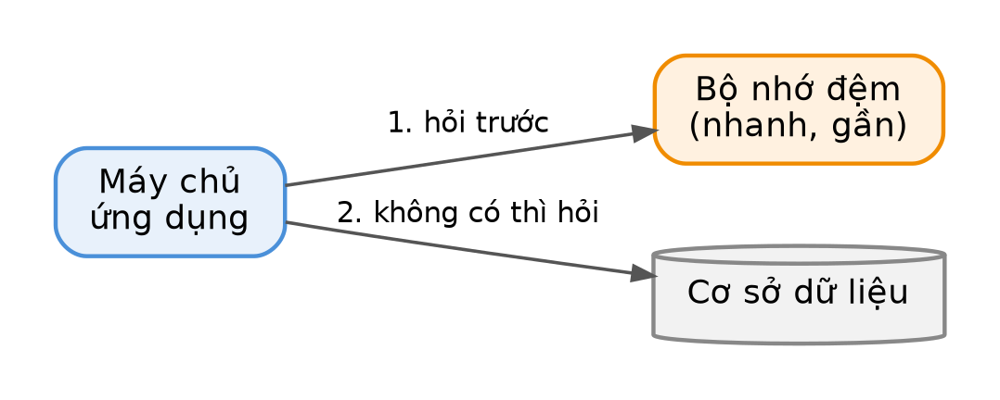

::: {.part title="Phần I — Tăng tốc hệ thống"}
:::

# Bộ nhớ đệm: Để đồ hay dùng ở gần

Chương này giải thích vì sao gần như mọi hệ thống nhanh đều dùng bộ nhớ đệm.

## Cache — "Để đồ hay dùng ở gần"

**Vấn đề:** Trang chủ cửa hàng online được hàng triệu người xem. Mỗi lần xem lại hỏi cơ sở dữ liệu thì máy chủ quá tải.

::: {.box kind="kid" title="Hiểu nhanh qua ví dụ đời thường"}
Bạn để chai nước trên bàn làm việc thay vì mỗi lần khát lại xuống căng-tin. Chai nước trên bàn chính là bộ nhớ đệm.
:::

**Giải pháp:** Hỏi bộ nhớ đệm trước; không có mới hỏi cơ sở dữ liệu, rồi cất kết quả lại.

{width=85%}

```java
SanPham laySanPham(String ma) {
    SanPham sp = cache.get("sp:" + ma);
    if (sp != null) return sp;                         // có sẵn: trả ngay
    sp = database.timSanPham(ma);                      // không có: đi lấy
    cache.set("sp:" + ma, sp, Duration.ofMinutes(5));  // cất 5 phút
    return sp;
}
```

::: {.box kind="warn" title="Cẩn thận: Dữ liệu cũ"}
Giá sản phẩm đổi mà bộ nhớ đệm vẫn giữ giá cũ. Hãy xoá mục trong bộ nhớ đệm mỗi khi dữ liệu gốc thay đổi.
:::

| Cách | Một câu để nhớ | Đời thường |
|---|---|---|
| TTL | Hết hạn sau một thời gian | Sữa có hạn sử dụng |
| LRU | Bỏ thứ lâu không dùng nhất | Dọn tủ lạnh khi đầy |

## Bài tập chương 1

::: {.box kind="ex" title="Bài tập"}
★ **1.1** Nghĩ ra một ví dụ đời thường khác cho bộ nhớ đệm.

★★ **1.2** Với tỉ lệ đọc trúng bộ nhớ đệm 90%, mỗi lần trúng mất 1 ms, mỗi lần trượt mất 50 ms. Tính thời gian trung bình.
:::
